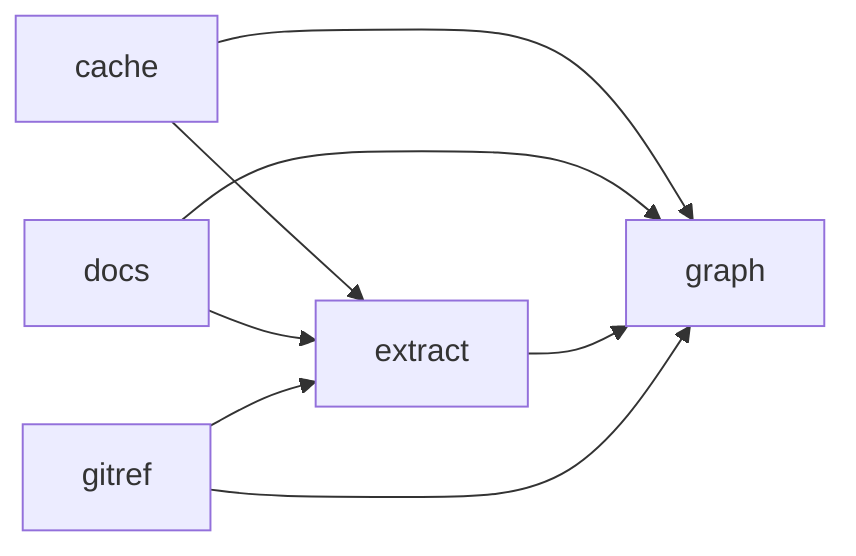

# repograph

Ask a Go repository what a change will affect.

repograph reads your Go source and answers questions about it: which HTTP routes a function can reach, what calls it, which tables it touches, and what your branch can break. There's no server or database to run, and no rebuild step to remember. When the code changes, the next question rebuilds the graph first.

```
$ repograph affected main

Changed since main (7):
  (*handler.fhirHandler).compartmentSearch  internal/handler/handlers.go:1796
  (*handler.fhirHandler).conditionalDelete  internal/handler/handlers.go:1083
  (*handler.fhirHandler).conditionalUpdate  internal/handler/handlers.go:1010
  (*handler.fhirHandler).create             internal/handler/handlers.go:707
  (*handler.fhirHandler).search             internal/handler/handlers.go:353
  (*handler.fhirHandler).searchPost         internal/handler/handlers.go:385
  handler.writeSearchParamError             internal/handler/handlers.go:1956

Routes that can be affected (6 of 32):
  DELETE  /fhir/r4/{resourceType}
  GET     /fhir/r4/{resourceType}
  POST    /fhir/r4/{resourceType}
  PUT     /fhir/r4/{resourceType}
  POST    /fhir/r4/{resourceType}/_search
  GET     /fhir/r4/{resourceType}/{id}/{targetResourceType}
```

That's a real branch of [wso2/fhir-server](https://github.com/wso2/fhir-server).

## Install

```bash
go install github.com/vibhuthespeedst/repograph/cmd/repograph@latest
```

It needs Go 1.26 or newer to build. Run it anywhere inside a Go module.

## Ask about the code

| Command | Answers |
|---|---|
| `repograph impact <name>` | What can a change here affect? Routes, callers and tests |
| `repograph callers <name>` | What uses this function? |
| `repograph callees <name>` | What does this function use? |
| `repograph path <from> <to>` | How does one function get to another? |
| `repograph tables <name>` | Which database tables can this reach? |
| `repograph routes [text]` | Which routes exist, and what handles them? |
| `repograph find <text>` | Where is the code for this? Searches names and doc comments |

Names can be bare (`Search`) or full (`(*store.Store).Search`). Calls through an interface are followed to the types in your repo that implement it, and so are references held in package-level tables.

Add `-json` to any question for output a script can read, `-tags integration` to include files behind build tags, and `-C <dir>` to run against another directory.

## Ask about a change

| Command | Answers |
|---|---|
| `repograph affected <ref>` | Which routes and tests can my changes since `<ref>` affect? |
| `repograph diff <ref>` | What changed in the code since `<ref>`? |

Both compare against where your branch left `<ref>`, like `git diff main...`, and include uncommitted work. Comment and formatting edits don't count as changes.

## How it stays current

Everything in the graph comes from the source, so nothing is maintained by hand.

- **Questions:** each one hashes your Go and SQL files and rebuilds if anything changed. A cached question takes about 50 ms, and a rebuild took seconds on a 1,100-function repo.
- **The cache:** it lives in your user cache folder, one per repo, and never inside the repo, so it never shows up in `git status` and a repo can't tamper with it. Set `REPOGRAPH_CACHE_DIR` to keep it somewhere else.
- **Hand-written docs:** `repograph docs` fails if a doc mentions a function or path that no longer exists.
- **Diagrams:** `repograph diagram` generates the package diagram, so it can't drift.

## Use it in CI

```yaml
- uses: actions/checkout@v4
  with:
    fetch-depth: 0 # affected needs the history
- run: go install github.com/vibhuthespeedst/repograph/cmd/repograph@latest
- run: repograph docs README.md docs/*.md
- run: repograph diagram -check README.md
- run: repograph affected origin/${{ github.base_ref }}
```

`docs` and `diagram -check` exit 1 when something is out of date, and 2 if they couldn't run. `affected` only reports, so it won't fail a build.

## Keep a diagram in your README

Add these two lines where the diagram should go:

```markdown
<!-- repograph:packages -->
<!-- /repograph:packages -->
```

Then run `repograph diagram -write README.md`. This is the diagram for this repo, generated that way:

<!-- repograph:packages -->

<!-- /repograph:packages -->

An arrow means "imports". Commands are left out, because they import most packages to wire them together and those arrows make the rest hard to read.

## What it can't do

- **`impact` is an upper limit.** A path existing in the code doesn't mean every request takes it.
- **`path` shows one shortest chain,** which may not be the one most requests take.
- **Routes are only read from [go-chi](https://github.com/go-chi/chi).** Everything else still works without them.
- **Tests are only linked through code.** A test that sends a request through the router won't show up against the handler it reaches.
- **Dynamic calls are invisible.** That includes reflection, generated code, and interfaces defined outside your repo. A function passed around as a value is linked where it's named, not where it's finally called.
- **Tables are found by matching text.** A string has to name the table after a SQL keyword or be exactly its name, and the table needs a `CREATE TABLE` in a `.sql` file. Names built at runtime are missed.
- **`docs` checks that a name exists in the code,** comments included, not that what the doc says about it is still true.
- **One module at a time.** For a repo with several, use `-C` for each.
- **It trusts the code as much as `go build` does.** Reading a module runs `go list`, which compiles it. Only run it on code you would build.

## Why not gopls?

If you only need the callers of a function, your editor already does that through `gopls`, and `golang.org/x/tools/cmd/callgraph` prints a raw call graph. repograph adds routes, tables and change-based impact, works from a terminal or CI, and checks your docs.

## How accurate is it?

It was checked against one real repo, wso2/fhir-server, so treat this as a good sign and not as proof:

- Import links matched `go list` exactly (31 of 31).
- Every call link in the graph was confirmed by a separate search of the source text.
- That text search also found 139 references the graph doesn't have. By name, they were library calls that share a name with a repo function, struct fields and SQL text. The 15 from a package-level table are in the graph, under the table's name. They weren't all read line by line.

If you find a wrong answer, please open an issue with the smallest code that shows it.

## Development

```bash
go test ./...
```

The tests run against a small sample module in `internal/extract/testdata/sample`, and the command tests build the real binary and run it in temporary git repositories.

## License

[MIT](./LICENSE)
